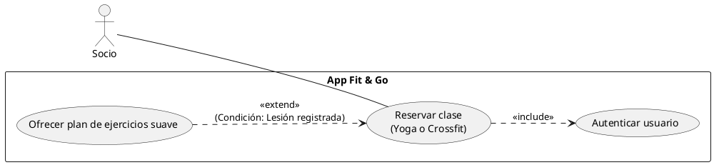
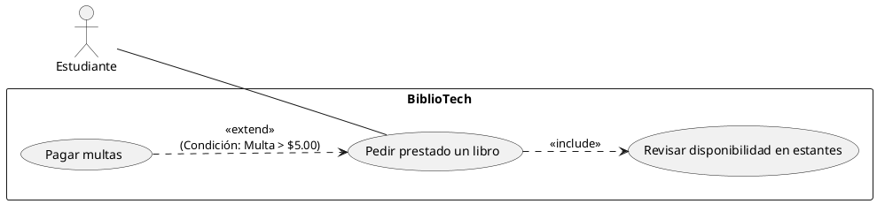
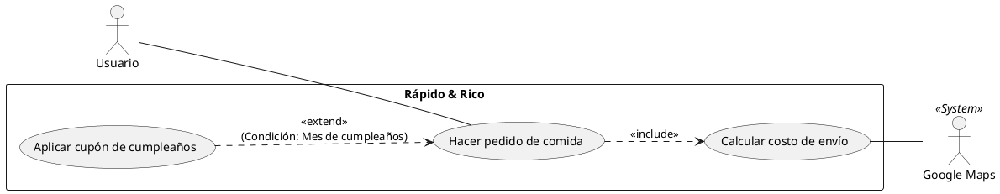

# Casos de uso Ingeniería de Requerimientos
## Ejercicio 1
- **Ejercicio en lenguaje natural**: "Quiero que el socio pueda reservar su clase de Yoga o Crossfit. Pero ojo, el sistema debe ser súper seguro, así que antes de dejarlo reservar nada, debe loguearse sí o sí. ¡Ah! Y si el socio tiene una lesión registrada en su perfil, el sistema debe avisarle y ofrecerle un plan de ejercicios suave de forma opcional antes de confirmar."
### Diagramas:

---
## Ejercicio 2
- **Ejercicio en lenguaje natural**:  "Necesito que el estudiante pueda pedir prestado un libro. Obviamente, el sistema tiene que revisar siempre si el libro está disponible en los estantes. Si por alguna razón el estudiante tiene una multa pendiente de más de 5 dólares, el sistema debe bloquear el préstamo y mandarlo directo a la pantalla de 'Pago de Multas' para que se arregle de inmediato."
    - **Reto del estudiante:** ¿Cómo definimos técnicamente "arreglarse de inmediato"?.
### Diagramas: 

---
## Ejercicio 3
- **Ejercicio en lenguaje natural:** "Quiero que el usuario haga su pedido de comida. Al pagar, el sistema siempre debe calcular el costo de envío según la distancia. Ahora, si el usuario tiene un 'Cupón de Cumpleaños' activo, quiero que le deje aplicarlo para que no pague nada de envío, pero solo si es su mes de cumple."
    - **Reto para el estudiante:** (Usuario y Google Maps como Sistema Externo para la distancia).
### Diagramas:

